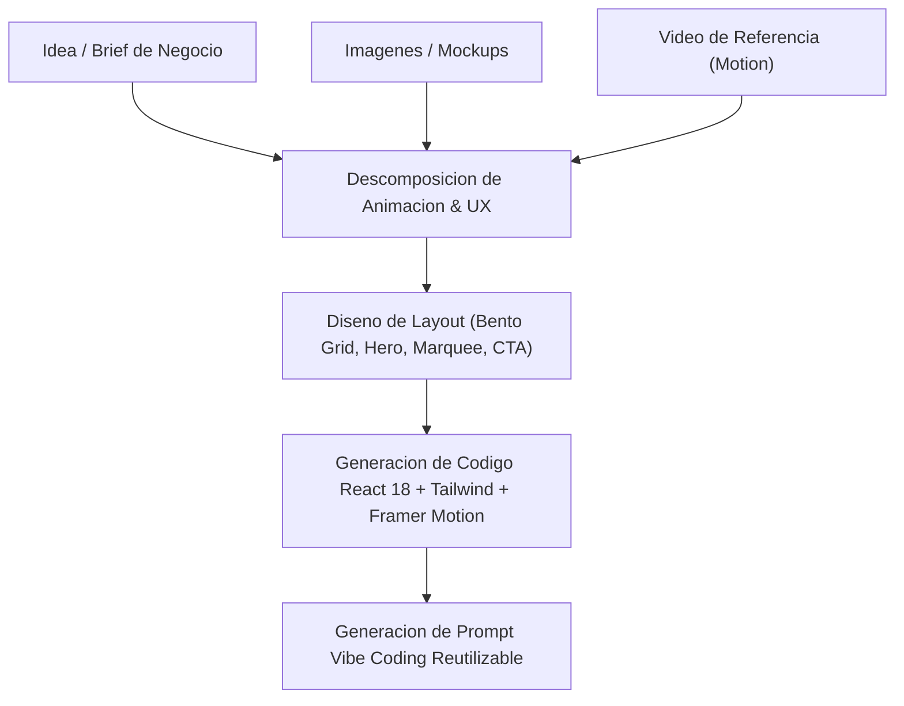

# Arquitectura y Pipeline Operativo: Motion Web Architect

## 1. Qué es
`motion-web-architect` es un Agente Personalizado y Subagente de Google Antigravity diseñado para transformar conceptos abstractos, requerimientos comerciales, referencias en video de interacción e imágenes estáticas en sitios web animados y componentes visuales interactivos de alto impacto bajo el estándar de **Dínamo Sites** y Awwwards.

---

## 2. Cómo funciona
El agente opera en modo simétrico (`mainAgent: true`, `subagent: true`), lo que permite seleccionarlo en la interfaz de usuario de Antigravity, invocarlo mediante `agy --agent motion-web-architect` o delegarle tareas desde el orquestador maestro (`projectai-master`).

### Flujo de Transformación Multimodal

---

## 3. Matriz de Entregables por Tipo de Input

| Input Recibido | Procesamiento del Agente | Entregable Técnico Generado |
| :--- | :--- | :--- |
| **Idea / Requisito Textual** | Estructuración de jerarquía de conversión y redacción comercial B2B. | Wireframe animado en código, paleta de colores y componentes reactivos. |
| **Video de Referencia** | Desglose de curvas de aceleración (Bézier), delays y triggers de scroll. | Lógica de animación con `framer-motion` (`useScroll`, `useTransform`, `staggerChildren`). |
| **Imágenes / Mockups** | Extracción de proporciones, jerarquía visual y paleta cromática. | Estructura Bento Grid responsiva, tarjetas interactivas con bordes luminosos y glassmorphism. |

---

## 4. Desarrollo: Ejemplo de Interacción

### Entrada de Usuario:
> *"Quiero una landing estilo Dinamo Sites para un servicio de auditorías de IA industrial. Fondo oscuro, microinteracciones en las tarjetas y botones con destello luminoso."*

### Salida del Agente:
1. **Componentes React Completos:** `HeroSection.jsx`, `BentoServices.jsx`, `MotionCTA.jsx`.
2. **Estilos Tailwind & Configuración:** Clases CSS de aceleración GPU (`transform-gpu`) y paleta monocromática oscura con acento esmeralda o violeta eléctrico.
3. **Prompt Maestro para LLMs / Vibe Coding:** Snippet listo para ser utilizado en cualquier sesión conversacional.
